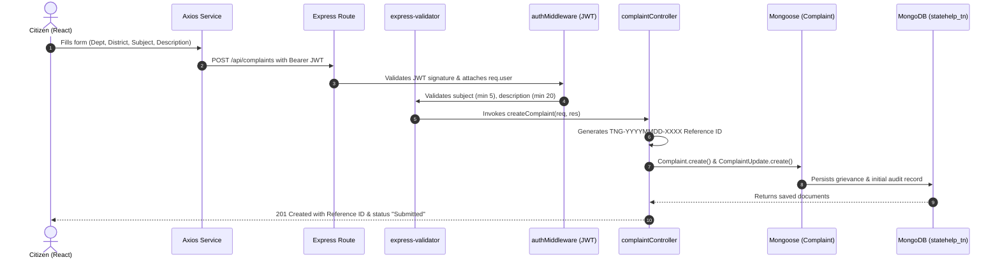

# Tamil Nadu State Helpline and Citizen Grievance Portal
> **Development Prototype** for unified citizen emergency helplines and grievance redressal.

---

## 1. Project Architecture & Standards

```
statehelp/
├── client/                          # React Frontend (Vite + Bootstrap 5 + Lucide + i18n)
│   ├── src/
│   │   ├── components/              # Navbar, Footer, EmergencyBanner, StatusBadge, Timeline
│   │   ├── context/                 # AuthContext (JWT) & LanguageContext (English/தமிழ்)
│   │   ├── pages/                   # Home, Helplines, Register, Track, Citizen & Admin Dashboards
│   │   ├── services/                # Axios API services (auth, helplines, complaints, admin)
│   │   ├── utils/                   # Bilingual dictionary & 38 TN Districts
│   │   ├── App.jsx                  # React Router configuration
│   │   ├── main.jsx                 # Bootstrap 5 & bundle setup
│   │   └── index.css                # TN Government palette (Navy #0b2545 & Green #137547)
│   └── package.json
└── server/                          # Node.js + Express.js REST API + MongoDB Mongoose
    ├── config/
    │   └── database.js              # Resilient MongoDB connection handler
    ├── controllers/                 # authController, helplineController, complaintController, adminController
    ├── middleware/                  # authMiddleware (JWT), roleMiddleware, errorMiddleware
    ├── models/                      # User, Department, Helpline, Complaint, ComplaintUpdate
    ├── routes/                      # authRoutes, departmentRoutes, helplineRoutes, complaintRoutes, adminRoutes
    ├── scripts/
    │   ├── seed.js                  # Database seeder with departments, helplines, accounts, grievances
    │   └── test-api.js              # Automated 8-step REST API integration test suite
    ├── utils/
    │   └── referenceGenerator.js    # Generates TNG-YYYYMMDD-XXXX grievance codes
    ├── validators/                  # Express-validator input sanitization
    ├── app.js                       # Express app with CORS, rate limiting, logging
    ├── server.js                    # HTTP listener
    └── package.json
```

---

## 2. Quick Start & Execution

### Prerequisites
- Node.js (v18+) and npm
- MongoDB Server running locally on `mongodb://127.0.0.1:27017`

### Step 1: Backend Setup & Database Seeding

Open a terminal in the `server/` directory:

```bash
cd server
npm install
node scripts/seed.js      # Seeds departments, helplines, accounts, and sample grievances
node server.js            # Starts Express server on http://localhost:5000
```

> **Run Automated Backend Integration Tests**:
> ```bash
> npm test
> # or: node scripts/test-api.js
> ```

### Step 2: Frontend Setup & Dev Server

Open a second terminal in the `client/` directory:

```bash
cd client
npm install
npm run dev               # Starts Vite dev server on http://localhost:5173
```

Now open **[http://localhost:5173/](http://localhost:5173/)** in your browser!

---

## 3. Seed Credentials & Testing Accounts

All seeded accounts use password: `Password@123`

| Role | Name | Email | Mobile | Assigned Department |
| :--- | :--- | :--- | :--- | :--- |
| **Administrator** | TN State Helpline Admin | `admin@statehelp.tn.gov.in` | `9876543210` | All Departments |
| **Police Officer** | Inspector S. Radhakrishnan | `officer.police@statehelp.tn.gov.in` | `9876543211` | Police (POL) |
| **Electricity Officer**| AE M. Karthik | `officer.tneb@statehelp.tn.gov.in` | `9876543212` | TANGEDCO (TNEB) |
| **Citizen** | K. Anand Kumar | `citizen@example.com` | `9876543220` | Chennai Resident |

> *Tip: The Login page features one-click "Fill" buttons for these accounts for instant testing.*

### Sample Pre-seeded Grievance Reference IDs for Tracking:
- `TNG-20261014-8169` (Status: **In Progress** - TANGEDCO Street Light failure)
- `TNG-20261014-2060` (Status: **Resolved** - Water Contamination)
- `TNG-20261014-1508` (Status: **Submitted** - Madurai School Zone Noise)

---

## 4. Full-Stack Learning Guide: How Data Flows

### A. Submitting a Citizen Grievance



### B. Core Backend Architectural Concepts Explained

1. **`async / await` & `try / catch`**:
   - Node.js is non-blocking. Database queries (like `Complaint.find()`) return Promises.
   - `await` pauses execution until MongoDB responds, keeping asynchronous code readable.
   - Any database disconnection or query failure jumps directly to the `catch(error)` block, which passes the error to `next(error)` for centralized handling.

2. **Middleware Pipeline**:
   - Express processes requests through a chain of functions.
   - `protect`: Verifies the token, fetches the user from MongoDB, attaches it to `req.user`, and calls `next()`.
   - `restrictTo('admin', 'officer')`: Verifies `req.user.role`. If a citizen tries to access `/api/admin/complaints`, it immediately rejects with `403 Forbidden`.

3. **Object-Level Authorization**:
   - In `getComplaintById`, the controller checks:
     ```js
     if (req.user.role === 'citizen' && complaint.citizenId.toString() !== req.user._id.toString()) {
       return res.status(403).json({ message: "Access denied" });
     }
     ```
   - This ensures a citizen cannot view another citizen's grievance even if they guess the MongoDB ObjectId.

4. **Data Minimization on Public Tracking (`/api/complaints/track/:refId`)**:
   - Anyone with a Reference ID can check its investigation stage.
   - However, the controller uses `.select('-description -citizenId')` to protect citizen privacy, only exposing public timeline milestones.

5. **Immutable Audit Trail (`ComplaintUpdate`)**:
   - Every time an officer changes a grievance status, an un-editable record is written to `ComplaintUpdate`.
   - Public updates are visible to citizens; internal investigative notes are confidential and restricted to staff.

---

## 5. REST API Endpoints Specification

### Authentication
- `POST /api/auth/register` — Citizen registration
- `POST /api/auth/login` — Authentication & JWT generation
- `GET /api/auth/me` — Current authenticated profile
- `POST /api/auth/logout` — Session termination

### Helplines
- `GET /api/helplines` — Public published helplines (with category & search filtering)
- `GET /api/helplines/:id` — Single helpline details
- `POST /api/admin/helplines` — Admin create helpline
- `PATCH /api/admin/helplines/:id` — Admin update helpline
- `DELETE /api/admin/helplines/:id` — Admin delete helpline

### Departments
- `GET /api/departments` — List active departments (bilingual)
- `POST /api/admin/departments` — Register department (Admin)

### Complaints
- `POST /api/complaints` — Citizen grievance submission (generates `TNG-YYYYMMDD-XXXX`)
- `GET /api/complaints/my` — Authenticated citizen's personal complaints
- `GET /api/complaints/track/:refId` — Public data-minimized status lookup
- `GET /api/complaints/:id` — Authenticated grievance details with ownership check

### Admin Triage
- `GET /api/admin/complaints` — Paginated complaint datatable with status & district filters
- `PATCH /api/admin/complaints/:id/assign` — Assign department officer
- `PATCH /api/admin/complaints/:id/status` — Status transition with mandatory audit notes
- `GET /api/admin/complaints/:id/history` — Full audit trail
- `GET /api/admin/reports/summary` — Analytics metrics by department and district

---

## 6. Government Readiness & Future Production Steps

| Requirement | Current Prototype Status | Production Road to Deployment |
| :--- | :--- | :--- |
| **Authentication** | JWT with bcrypt hashing | Integrate Tamil Nadu Single Sign-On (e-Sevai / TNeGA SSO) and Aadhaar/OTP verification. |
| **SMS/Email Notifications** | Mock logging | Integrate State CDAC / NIC SMS Gateway for grievance updates. |
| **Hosting & SSL** | Localhost HTTP | State Data Centre (TNeGA SDC) hosting with TLS 1.3 encryption. |
| **Auditing & Cert-In** | Standard error sanitization | Mandatory third-party Cert-In security audit and penetration testing. |
| **Disaster Recovery** | Single MongoDB instance | High-availability MongoDB replica set across multi-zone state government data centers. |
